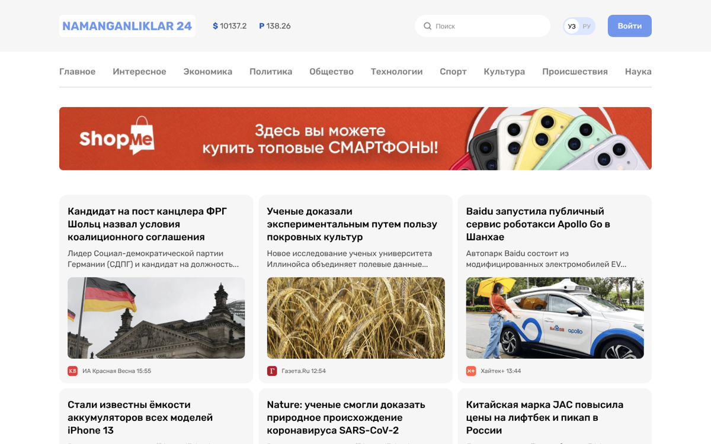

# Namanganliklar24 — News Portal

A multi-page news website layout: header with currency rates and search, category navigation, ad banner, news cards with source and time, and "In the world" / "Main" sections. Includes a login page and two inner article pages.

**Live demo:** https://nodirkhuja.github.io/Namanganliklar/

## Built with
HTML5, CSS3 (Flexbox), custom fonts

Pages: `index.html`, `second.html`, `third.html`, `login.html`

## About
Learning project from my frontend development course (2022–2023). Layout is built for desktop screens.

Today I focus on AI agents and business automation (n8n, ERP/CRM and API integrations, Telegram bots).
